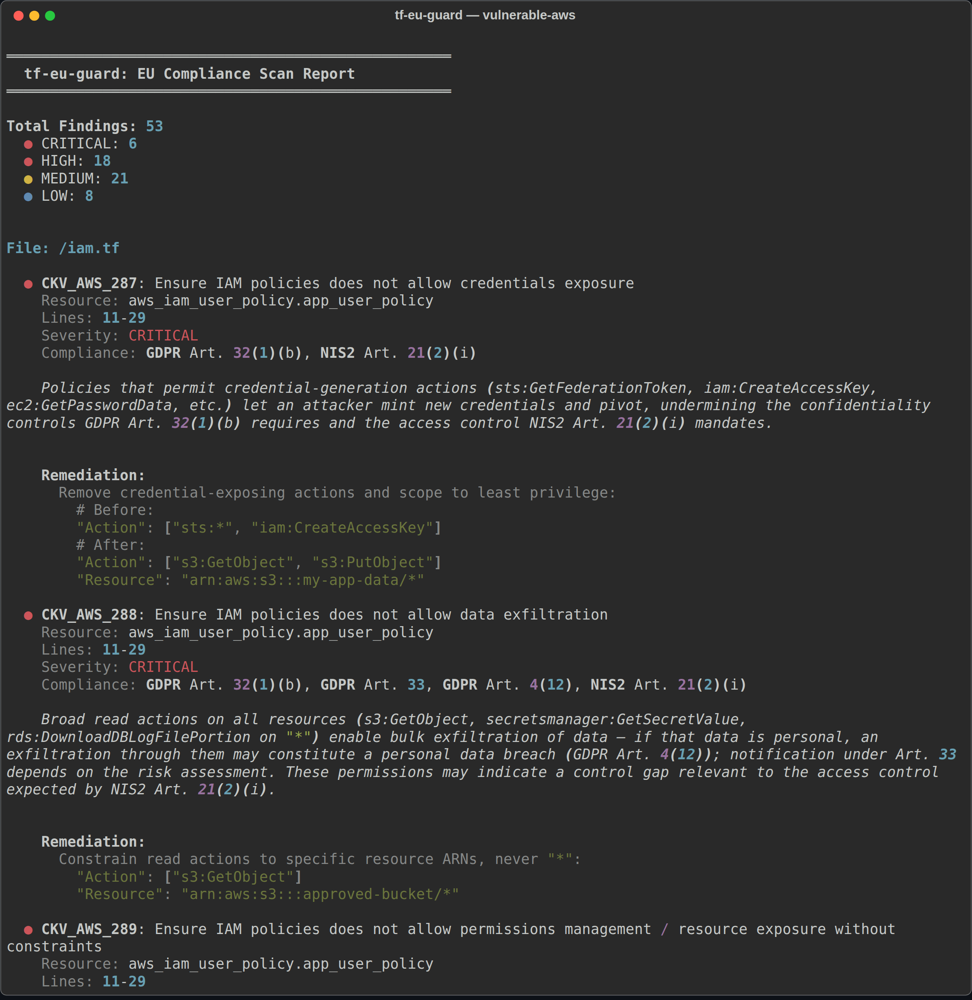
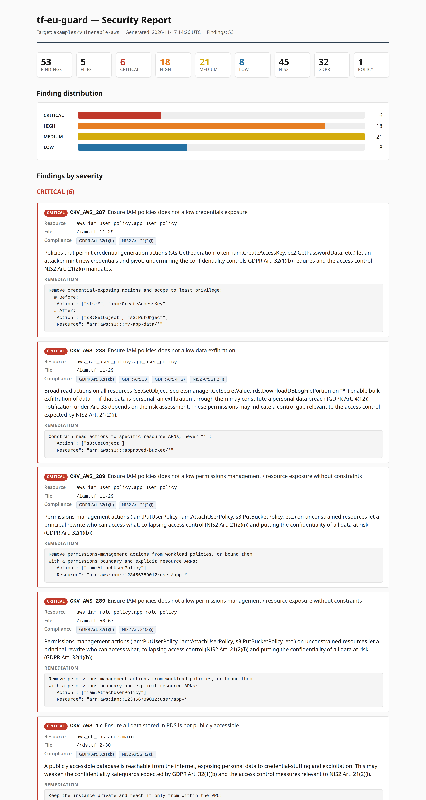

# tf-eu-guard — NIS2/GDPR compliance scanner for Terraform and Kubernetes

[](https://github.com/44aayush/tf-eu-guard/actions/workflows/ci.yml)
[](https://pypi.org/project/tf-eu-guard/)
[](https://www.python.org/downloads/)
[](https://www.checkov.io/)
[](LICENSE)
[](docs/check-mapping-table.md)

**Links:** [PyPI package](https://pypi.org/project/tf-eu-guard/) · [Documentation](#documentation) · [Changelog](CHANGELOG.md)

**EU compliance security linter for infrastructure as code (IaC).** It scans Terraform source, Terraform plan JSON, and Kubernetes manifests with Checkov, then maps infrastructure misconfigurations to NIS2 (Directive 2022/2555) and GDPR (Regulation 2016/679) requirements. It is built for Terraform security scanning, Kubernetes compliance checks, DevSecOps pipelines, GitHub Actions, SARIF, and audit preparation.

---

## Problem

The [NIS2 Directive](https://eur-lex.europa.eu/eli/dir/2022/2555) set **October 17, 2024** as the deadline for Member States to adopt and publish national transposition measures; applicability and enforcement still depend on national law and whether an entity is in scope. Article 21(2) mandates risk-management measures including access control, encryption, incident handling, backup policies, and secure authentication. GDPR Article 32 imposes similar technical and organizational safeguards for processing personal data.

Most organizations scan infrastructure-as-code with tools like Checkov or tfsec, but the output is generic security findings, not compliance mappings. Security teams must manually trace each finding to the relevant NIS2 or GDPR article, a slow and error-prone process that blocks audit preparation.

tf-eu-guard wraps Checkov, enriches each failed check with the relevant NIS2/GDPR article references, and produces reports structured for developers, security engineers, and auditors.

---

## What It Does

1. **Scans IaC using Checkov** — Terraform source, Terraform plan JSON (`terraform show -json`), and Kubernetes manifests (`--iac-type`)
2. **Enriches findings** with NIS2 Article 21(2), GDPR Article 32(1) / 44, and the project's region residency policy mappings from a curated registry
3. **Reports mapped and unmapped findings separately** — Checkov failures with no current EU mapping are surfaced as counts in terminal/HTML reports, a stderr note beside JSON, and full note-level SARIF results, never silently dropped; see [Unmapped findings](#unmapped-findings)
4. **Generates three report formats** from one scan:
   - **Dev report** (terminal/HTML): severity-sorted findings for engineers
   - **Security dashboard** (HTML): CRITICAL/HIGH/MEDIUM/LOW breakdown with stats
   - **Auditor report** (HTML): article-by-article view showing which NIS2/GDPR clauses and project-policy controls have open findings
5. **Custom checks**: Adds EU-specific rules (configurable region residency policy for AWS, Azure and GCP, third-country transfer review, and selected hardcoded secrets) not in upstream Checkov

> **Note on flags:** `--iac-type` selects *what to scan* (terraform, terraform_plan, kubernetes);
> `--framework` selects *which regulatory regime to report* (nis2/gdpr). `all` also retains
> project-policy findings such as the EUSC sovereignty control. They are unrelated.

---

## Quick Start

### Installation

Requires **Python ≥ 3.11**. Installs Checkov 3.4.5 as a dependency. [uv](https://docs.astral.sh/uv/) is optional; plain `pip` works too.

```bash
uv tool install tf-eu-guard
```

Install it in its own environment (`uv tool install` or `pipx install`): a package that depends on
python-hcl2, such as terraform-local, overwrites the `hcl2` module that Checkov's bc-python-hcl2 provides, and
every scan then fails with exit 3 and a message naming the cause.

(Also available on PyPI: [tf-eu-guard](https://pypi.org/project/tf-eu-guard/); with pip, `pip install tf-eu-guard`.)

For development (from a clone of this repo):

```bash
uv sync --extra dev        # or: python -m venv .venv && .venv/bin/pip install -e '.[dev]'
```

`uv sync` also writes a `uv.lock` in the repository root. It is a local
artefact (the project's pinned locks are the `requirements*.lock` files), and
it is gitignored, so do not commit it.


### Basic Scan

```bash
# Scan a Terraform directory
tf-eu-guard scan ./terraform --output dev

# Generate all three HTML reports
tf-eu-guard scan ./terraform --output all

# Filter to GDPR-only findings and output JSON
tf-eu-guard scan ./terraform --output json --framework gdpr

# Markdown summary or CSV (one row per finding and article); also write a summary and counts
# file (key=value, GitHub $GITHUB_OUTPUT format) next to any other --output
tf-eu-guard scan ./terraform --output csv --output-file findings.csv
tf-eu-guard scan ./terraform --output json --summary-file summary.md --counts-file counts.txt

# Fail the build (exit code 1) on HIGH or worse findings — for CI/CD
tf-eu-guard scan ./terraform --fail-on-severity HIGH

# In CI on a pull request: do not read .tf-eu-guard.yaml or .tf-eu-guard-waivers.yaml from the
# scanned tree (its author controls them) and read the config from outside the checkout, copied
# from the base branch. A --config or --waivers path inside the checkout is just as PR-controlled.
git show "origin/$GITHUB_BASE_REF:.tf-eu-guard.yaml" > "$RUNNER_TEMP/tf-eu-guard.yaml"
tf-eu-guard scan ./terraform --no-discovery --config "$RUNNER_TEMP/tf-eu-guard.yaml"

# Skip paths (repeatable; Checkov --skip-path semantics: regex or substring of the absolute path)
tf-eu-guard scan . --exclude tests/fixtures --exclude vendor

# Show the registry entry (severity, articles, risk, remediation) for one check
tf-eu-guard explain CKV_AWS_16

# Layer your own registry entries over the bundled ones (repeatable; later wins), then lint them
tf-eu-guard scan ./terraform --registry-dir ./our-registry
tf-eu-guard registry validate ./our-registry
```

**Network behaviour.** Scans run Checkov with `--skip-download`, so no request
is made to the Prisma Cloud platform and reports have no "Documentation" links.
`--online` allows Checkov to fetch that metadata. `BC_*`, `PRISMA_*` and
`CKV_IGNORE*` environment variables (platform API keys included) are always
removed from Checkov's environment, even with `--online`. See
[`docs/limitations.md`](docs/limitations.md) and [`SECURITY.md`](SECURITY.md).

**Remote modules.** Checkov does not download modules, so resources inside
registry or Git modules are not analysed; a stderr warning lists such module
calls, and `CKV_TF_1`/`CKV_TF_2` (module pinning) map to NIS2 Art. 21(2)(d).
`--download-external-modules` lets Checkov fetch them (network access, third-party
code; Terraform source scans only). The GitHub Action runs with `--network none`, so
that flag does not work there. `--var-file FILE` (repeatable) passes Terraform variable
files so values such as a provider region set via `var.*` resolve.

**Secrets.** `--secrets` also runs Checkov's `secrets` framework (hard-coded credentials,
`CKV_SECRET_*`, mapped to NIS2 Art. 21(2)(e) and GDPR Art. 32(1)(b), severity HIGH). It
works with Terraform, Terraform plan, Kubernetes and `--checkov-json` (a `secrets` element in
the file is merged; none means no secret findings). Reports show the secret type and file
location only: the secret value, code excerpt and Checkov's hash of the secret are never
copied into any output. Parsing errors in the secrets scan fail the run like any other.

> **Try it:** Run `tf-eu-guard scan examples/vulnerable-aws/ --output all` to see ~53 mapped findings,
> or `tf-eu-guard scan examples/compliant-aws/ --output dev` to see zero mapped findings on the compliant fixture.

### Scan Terraform Plan JSON

Plan-mode scanning catches the configuration as it will actually be applied.
Generate the plan JSON, then scan it:

```bash
terraform plan -out=tfplan.binary
terraform show -json tfplan.binary > plan.json
tf-eu-guard scan plan.json --iac-type terraform_plan --output json
```

> Plan mode runs Checkov against the plan file itself (`checkov -f <plan.json>
> --framework terraform_plan`). It reuses the same `CKV_AWS_*` check IDs as source
> mode (verified: a plan of `examples/vulnerable-aws` maps 31 findings, all to
> existing registry entries), minus lifecycle-block checks that plan JSON doesn't
> store. Findings report `file_line_range: [0, 0]` (the whole plan is one JSON
> line), so reports omit the line reference.
> A committed fixture lives at `examples/vulnerable-aws-plan/`.
>
> Note: `--checkov-json` is a *different* feature — it reuses Checkov JSON output
> you already generated (see below). Passing a raw `terraform show -json` plan
> file to `--checkov-json` is an error; scan the plan file directly as shown
> above.

### Scan Kubernetes

```bash
tf-eu-guard scan ./k8s --iac-type kubernetes --output all
```

> **Try it:** `tf-eu-guard scan examples/vulnerable-kubernetes/ --iac-type kubernetes --output json`
> returns ~24 mapped findings across pod security context, RBAC, network policy, secrets and
> resource limits. Kubernetes checks live in the separate `CKV_K8S_*` namespace, mapped in
> `registry-kubernetes.yaml`.

### Use Pre-Generated Checkov JSON

If you already run Checkov in CI or with custom checks, feed tf-eu-guard the
**Checkov output** JSON directly (not a raw Terraform plan file; use
`--iac-type terraform_plan` for that):

```bash
# From a file
checkov -d ./terraform --output json --framework terraform --quiet > checkov.json
tf-eu-guard scan --checkov-json checkov.json --output security

# From stdin
checkov -d ./terraform --output json --framework terraform --quiet \
  | tf-eu-guard scan --checkov-json - --output auditor
```

> **Limits of pre-generated JSON.** tf-eu-guard cannot re-run what Checkov did, so it checks the file instead:
>
> - **Parsing errors fail the scan.** If `summary.parsing_errors` is above 0 (in any element of a multi-framework array), tf-eu-guard exits with the same runtime-failure code as a source scan, because unparsed files were never checked. `--allow-partial` downgrades this to a stderr warning in both modes.
> - **Checkov version.** If `summary.checkov_version` differs from the installed Checkov, a warning names both versions.
> - **Custom checks and empty results.** If no `EUGUARD_*` result appears in the passed, failed or skipped lists, a warning says the residency and secret checks may not have run (the residency checks need a region or location in the source, for AWS, Azure or GCP, so region-less input legitimately has none); regenerate the file with `checkov --external-checks-dir <tf_eu_guard>/checks` (the warning prints the path). If `summary.resource_count` is 0, a warning says nothing was scanned. When a gate is set (`--fail-on-severity`, `--fail-on-any`, `--fail-on-suppressed` or `--fail-on-unmapped`), an empty or incomplete Checkov JSON (no positive integer `resource_count`: missing summary, missing key, a string, a boolean or 0) fails the scan with the runtime-failure code instead, and `--allow-partial` downgrades it to the warning. A file forged with a positive `resource_count` can still pass: the gate is only as trustworthy as the producer of the JSON.
> - The residency flags (`--residency-policy`, `--allowed-regions`) are ignored; the results reflect the policy in effect when Checkov ran.

> Use `--framework terraform` in Checkov to get a single JSON object. tf-eu-guard also handles the multi-check-type array and extracts the `terraform` result automatically.

> Checkov results must identify the requested IaC type when `check_type` is
> present. Arrays are accepted only when they contain a matching element. For
> compatibility, a single legacy object without `check_type` is interpreted as
> the requested type. Source scans fail closed on Checkov parsing errors and
> empty/unsupported directories; `.tf.json` source files are not supported by
> the selected Checkov framework (use Terraform HCL or scan a plan with
> `--iac-type terraform_plan`).

> **Symlink boundary:** For a source-directory scan, tf-eu-guard resolves every
> symlink before Checkov runs. A symlinked file or directory that resolves
> outside the requested scan root (or a broken symlink) is rejected with exit
> code `2`. Symlinks that resolve inside the scan root are allowed; Checkov
> scans their targets, and directory cycles are visited only once. Plan-file
> scans are not directory traversals and do not apply this source-root check. A Terraform module
> `source` of `./` or `../` that resolves outside the scan root is not rejected: Checkov scans it, and
> tf-eu-guard prints a warning on stderr. Scan the common parent directory instead.

### Use as a Claude Code Skill

This repo includes a Claude Code skill at `.claude/skills/tf-eu-guard/`. In Claude Code:

```
/tf-eu-guard ./terraform
```

Or just ask: *"Check my Terraform for NIS2 and GDPR compliance"* — Claude runs the scan and summarizes findings by framework and severity.

---


### Evidence bundle and provenance

`--evidence-dir DIR` writes `dev.html`, `security.html`, `auditor.html`, `report.json` (object
format), `report.sarif`, `summary.md` and `manifest.json` into a new or empty `DIR` (otherwise
exit 2), in addition to the normal `--output`. `manifest.json` holds `created`, `provenance` and
the SHA-256 of every other file. `provenance` (also in the JSON object and the auditor report)
has `tool_version`, `checkov_version`, `registry_sha256` and `registry_files` (overlays by full
path), `commit` (the HEAD sha; uncommitted changes are not detected; null outside git unless the
`TF_EU_GUARD_COMMIT` environment variable holds a 40- or 64-character lowercase hex id),
`commit_source` (`git`, `environment` or null), the effective `options`
(no environment variables), `resources_scanned` and `checks` (`passed`, `failed`, `skipped`).
The `python:3.12-slim` image the Action runs in has no git, so the Action resolves the commit on the
runner (`git rev-parse HEAD` in the scanned directory, or the workspace with `checkov-json`, with
fsmonitor and hooks disabled) and passes it in `TF_EU_GUARD_COMMIT`: `provenance.commit` is the scanned
checkout's HEAD (on `pull_request` that is the merge commit GitHub checks out, not the branch tip), with
`commit_source` `environment`. `GITHUB_SHA` is only the fallback when that directory is not a git
repository, because under `pull_request_target` or a checkout with `ref:`, `repository:` or `path:` it
is not the scanned code's commit. A
`--checkov-json` run still records no commit.

To attest the bundle in CI, use GitHub artifact attestations on it, for example
`actions/attest-build-provenance` with `subject-path: evidence/*`.

## Documentation

- [Architecture and data flow](docs/architecture.md) — how Checkov findings become enriched compliance results
- [NIS2 mapping guide](docs/nis2-mapping.md) — Article 21(2) coverage and reasoning
- [GDPR mapping guide](docs/gdpr-mapping.md) — Article 32 and Article 44 coverage
- [Regulatory coverage](docs/regulatory-coverage.md) — automated, partial, manual, and out-of-scope requirements
- [Checkov mapping table](docs/check-mapping-table.md) — registry-backed check IDs, severity, risk, and remediation
- [Checkov coverage by release](docs/checkov-coverage.md) — every check of the pinned Checkov as mapped, intentionally unmapped, or untriaged
- [Limitations](docs/limitations.md) — what an IaC scanner can and cannot establish
- [Demo walkthrough](docs/DEMO.md) — reproducible vulnerable and compliant scans
- [Changelog](CHANGELOG.md) — release history

---

## Usage

### Developer Scan

Quick terminal output for engineers fixing issues:

```bash
tf-eu-guard scan ./terraform --output dev
```



### Security Dashboard

HTML report with severity breakdown and compliance tags:

```bash
tf-eu-guard scan ./terraform --output security
```



> Live HTML version: [`docs/screenshots/scan-report.html`](https://github.com/44aayush/tf-eu-guard/blob/main/docs/screenshots/scan-report.html)

### Auditor Compliance Matrix

Article-by-article view for audit preparation:

```bash
tf-eu-guard scan ./terraform --output auditor
```


> Live HTML version: [`docs/screenshots/auditor-report.html`](https://github.com/44aayush/tf-eu-guard/blob/main/docs/screenshots/auditor-report.html)

### JSON (CI/CD & Tooling)

Machine-readable output for pipelines:

```bash
tf-eu-guard scan ./terraform --output json --framework nis2
```

### SARIF (GitHub Code Scanning)

```bash
tf-eu-guard scan ./terraform --output sarif > tf-eu-guard.sarif
```

Emits a [SARIF 2.1.0](https://docs.oasis-open.org/sarif/sarif/v2.1.0/sarif-v2.1.0.html)
document, the format GitHub Code Scanning ingests directly. Each finding
becomes a `result` with `ruleId` = Checkov check ID, `level` derived from
severity (CRITICAL/HIGH → `error`, MEDIUM → `warning`, LOW/INFO → `note`),
and a `physicalLocation` from the finding's file and line range. For mapped
findings, the registry-backed EU context (NIS2/GDPR articles, severity, and
remediation) rides along in `properties` on both the rule and the result for
other SARIF consumers; Code Scanning itself does not render those custom
properties. What it does show: each rule's `help` (remediation and the article
list), `properties.tags` (`security`, the framework, and article labels such as
`NIS2 Art. 21(2)(f)`, usable as filters), and `properties.security-severity`
for ranking (CRITICAL 9.5, HIGH 8.0, MEDIUM 5.5, LOW 3.0, INFO 0.0; unmapped
rules carry none and rank by `level`). Each result has a
`partialFingerprints["tfEuGuard/v1"]` (sha256 of check ID, resource and
repository-relative file) so alerts stay stable across runs. A finding whose
file is outside the repository gets a file-level location at the repository
root (`"."` under `%SRCROOT%`) instead of an empty `locations` array. Unmapped Checkov
findings are included as `note`-level results with their Checkov identity,
resource, and location, tagged `properties.mapped: false`; they carry no
registry remediation or severity.

The document is validated against the official OASIS SARIF 2.1.0 JSON
schema in the test suite (`tests/test_sarif_report.py`). Use
`--output-file results.sarif` to write the file directly instead of stdout.

`--output json` honours `--output-file` too (UTF-8). `--json-format object`
selects a versioned document with `schema_version: "3"`, `tool`,
`checkov_version`, `scan`, `summary`, `findings` (check name, line range, risk
text, remediation, articles with titles, suppression), `unmapped`,
`requirements` (15 rows with `--framework all`, otherwise only that framework's rows, of passed/failed/suppressed/waived check-result counts
per NIS2/GDPR requirement), `registry` (loaded overlays and overridden check IDs)
and `waived`; its JSON Schema ships in the package as
`tf_eu_guard/schemas/report.schema.json` (`tf_eu_guard.REPORT_SCHEMA_PATH`). The default `--json-format array`
keeps the legacy bare array and is deprecated: the default will change to
`object` in a future release, and an implicit `--json-format` (flag omitted) now prints a
warning on stderr. Pass `--json-format array` or `object` explicitly to silence it (Action input `json-format`).

### Generate All Reports at Once

```bash
tf-eu-guard scan ./terraform --output all
```

### CI/CD Gating

Exit codes make tf-eu-guard usable as a pipeline gate. They distinguish
"the scan ran and found blocking issues" from "the tool itself failed to
run", so a pipeline can fail the build on findings while paging someone
when the scanner is broken:

| Exit code | Meaning |
|-----------|---------|
| `0` | Scan ran; no findings met the `--fail-on-*` threshold |
| `1` | Scan ran; blocking findings found (threshold met) |
| `2` | Invalid invocation or configuration — bad flags, unusable or undecodable `--checkov-json` input, missing target path, a report destination that cannot be written or encoded (`--output-file`, `--output-dir`, terminal encoding) |
| `3` | Scanner/runtime failure — Checkov crashed or exceeded `--timeout` (default 600 s, `0` disables), the mapping registry failed to load |

```bash
tf-eu-guard scan ./terraform --fail-on-severity HIGH   # exit 1 on HIGH or CRITICAL
tf-eu-guard scan ./terraform --fail-on-any             # exit 1 on any finding
tf-eu-guard scan ./terraform --fail-on-suppressed      # exit 1 if a mapped finding is suppressed inline
tf-eu-guard scan ./terraform --waivers waivers.yaml    # accepted findings leave the gate but stay listed (docs/waivers.md)
tf-eu-guard scan ./terraform --baseline old.json --fail-on-any  # only findings absent from old.json fail
tf-eu-guard diff old.json new.json                     # new / fixed / unchanged between two JSON reports
tf-eu-guard scan ./terraform --show-unmapped          # list unmapped Checkov findings in dev/HTML reports
tf-eu-guard scan ./terraform --fail-on-unmapped         # exit 1 if any active unmapped finding exists (with --baseline: not in the baseline)
tf-eu-guard scan ./terraform --residency-policy eusc   # Sovereign Cloud only (default: eu-eea)
tf-eu-guard scan ./terraform --residency-policy custom --allowed-regions eu-central-1,eu-west-1
```

A pipeline can gate on findings while treating tool failure separately:

```bash
tf-eu-guard scan ./terraform --fail-on-severity HIGH
case $? in
  0) echo "clean" ;;
  1) echo "blocking findings — failing the build"; exit 1 ;;
  2|3) echo "tf-eu-guard itself failed — tooling problem, not a findings verdict"; exit 2 ;;
esac
```

> **Gating considers only mapped findings by default.** Severity is authored in the mapping
> registry, so an unmapped Checkov finding has no severity to compare and, unless
> `--unmapped-severity` is set, never trips `--fail-on-severity` / `--fail-on-any`.
> It is reported for visibility instead (a note is printed to stderr whenever
> unmapped findings exist during a gated run). To gate on them, count each active
> unmapped finding at a severity you choose:
>
> ```bash
> tf-eu-guard scan . --fail-on-severity HIGH --unmapped-severity HIGH
> ```
>
> Unmapped findings are never waived, but a `--baseline` file does cover them, so with
> `--unmapped-severity` only unmapped findings new since the baseline count; use an
> inline `checkov:skip` to exempt one.

> **Inline suppressions are reported, not gated by default.** Findings that
> Checkov moved to `skipped_checks` because of `#checkov:skip=ID:reason`
> comments (Terraform) or `checkov.io/skip` annotations (Kubernetes) are listed
> in every report with check ID, resource, file and stated reason, but they do
> not count toward `--fail-on-severity` / `--fail-on-any`. Add
> `--fail-on-suppressed` to exit 1 when any *mapped* finding is suppressed.
> See [`docs/limitations.md`](docs/limitations.md#inline-suppressions).

### Waivers (`--waivers`)

> **Waivers are reviewed acceptances, still visible.** `--waivers FILE` (default:
> `.tf-eu-guard-waivers.yaml` in a source scan's root) takes YAML entries with
> `check_id`, `resource`, optional `file` glob, `owner`, `reason` and `expires`. A waived
> mapped finding does not count toward any `--fail-on-*` gate (an inline-suppressed one
> no longer trips `--fail-on-suppressed`) but is listed in every report, and expired
> waivers stop applying with a warning, and `--max-waiver-days N` refuses waivers that expire
> more than N days ahead. Unmapped findings cannot be waived. See
> [`docs/waivers.md`](docs/waivers.md).

### Baseline (`--baseline`) and `diff`

> `--baseline FILE` takes an earlier JSON report (`--output json`, either format; also
> works with `--checkov-json`). Active mapped findings with the same check ID, resource
> and file path (line numbers ignored) become "Known (in baseline)": listed in every
> report (JSON `baselined[]`, SARIF `baselineState: unchanged`) but outside the
> `--fail-on-severity` / `--fail-on-any` gate, so CI fails only on new findings. Active
> unmapped findings match the same way (check ID, resource, file path) against the baseline's
> `unmapped[]` and `baselined_unmapped[]`; known ones move to the JSON object's
> `baselined_unmapped[]`, so `--fail-on-unmapped` and `--unmapped-severity` see only new ones.
> Matching ignores whether a check is mapped: a finding in either list of the baseline stays known
> after a registry overlay or upgrade maps (or unmaps) its check. An array baseline cannot record
> unmapped findings, so unmapped findings count as new unless the baseline recorded the same check as
> a mapped finding (a note says so; write baselines with `--json-format object`); SARIF then
> leaves `baselineState` off unmapped results that are not matched.
> Waivers still never cover unmapped findings.
> The baseline's date and match counts appear under "Scan settings that reduce findings".
> `tf-eu-guard diff OLD.json NEW.json [--json]` prints new, fixed and unchanged counts
> and lists the new and fixed findings; it exits 1 when there are new findings, 2 on
> unreadable input. Suppressed and waived entries are not compared; baselined ones count as present (they still fail).

### Changed-only mode (`--changed-since REF`)

> `tf-eu-guard scan ./terraform --changed-since origin/main` reports only findings in files
> that differ from `REF` (committed `REF...HEAD` and staged; unstaged and untracked changes
> are not included). For Terraform, a changed `.tf`, `.tfvars` or `.hcl` file widens the scope to its
> module directory, that directory's parents and its subdirectories, because a variable change can
> affect resources in other files; sibling modules reached through `../` sources are not followed.
> Kubernetes findings are matched by file. It filters active, suppressed, waived, baselined and unmapped findings, but
> not the passed checks, so the requirement matrix still reflects everything evaluated. The
> count of hidden findings is printed on stderr and listed under "Scan settings that reduce
> findings". An unknown ref, a missing `git` or a non-repository exits 2, as do
> `--checkov-json` and `--iac-type terraform_plan`. It is a flag only, not a config key.

### Project configuration (`.tf-eu-guard.yaml`)

> Put defaults in `.tf-eu-guard.yaml` in the scan root (or pass `--config FILE`;
> `--no-config` ignores it). Keys are the flag names in snake_case; CLI flags win and
> `exclude` / `registry_dirs` concatenate. `severity_overrides` re-grades mapped checks.
> Anything that reduces findings (excludes, waivers, severity overrides, overlays, the
> config file) is listed under "Scan settings that reduce findings" in every report.
> See [`docs/configuration.md`](docs/configuration.md).

### Unmapped findings

Across all registries, **283 Checkov check IDs are mapped**: **AWS: 189 | Azure: 25 | GCP: 24 | Kubernetes: 26 | Secrets: 19** (the secrets entries apply only with `--secrets`). With 189 of Checkov's ~700 AWS checks mapped,
a scan can produce Checkov failures that have no current EU regulatory mapping.
These are **not** silently dropped: every report format surfaces them as
"present-but-unmapped" — a count in the dev/security/auditor reports, a
stderr note alongside the JSON output, note-level results tagged
`mapped: false` in the SARIF output, and an explicit mention in each
report's caveats. Unmapped checks are those with no honest compliance link
(see [`docs/check-mapping-table.md`](docs/check-mapping-table.md) for the
methodology); if you believe a check deserves a mapping,
[contribute one](CONTRIBUTING.md).

Try it: `tf-eu-guard scan examples/unmapped-aws/ --output dev` — a fixture that
deliberately mixes mapped S3 findings with the unmapped password-policy check
family (`CKV_AWS_10`–`15`).

### GitHub Action

```yaml
- uses: 44aayush/tf-eu-guard@v0.9.0
  with:
    path: './infra'
    iac-type: 'terraform'        # terraform | terraform_plan | kubernetes
    output: 'dev'                # dev | security | auditor | json | sarif | all
    framework: 'all'             # nis2 | gdpr | all
    fail-on-severity: 'HIGH'     # empty ('') disables gating
```

The Action requires a Linux runner with Docker (for example `ubuntu-latest`);
macOS and Windows runners are not supported. It runs the same CLI inside the repo's Docker image (pulled from
`ghcr.io/44aayush/tf-eu-guard:<action ref>` when published, built locally
otherwise), so it supports
every `--iac-type` the CLI does — pass the `terraform show -json` plan file
as `path` with `iac-type: terraform_plan`, or point at a manifest directory
with `iac-type: kubernetes`.

Action inputs mirror the scan options:

| Input | CLI equivalent | Default |
| --- | --- | --- |
| `path` | positional `PATH` (workspace-relative, or absolute under the workspace; `..` is rejected) | `./terraform` |
| `output` | `--output` | `dev` |
| `iac-type` | `--iac-type` | `terraform` |
| `framework` | `--framework` | `all` |
| `fail-on-severity` | `--fail-on-severity` | `HIGH` |
| `fail-on-any` | `--fail-on-any` | `false` |
| `fail-on-suppressed` | `--fail-on-suppressed` | `false` |
| `fail-on-unmapped` | `--fail-on-unmapped` | `false` |
| `unmapped-severity` | `--unmapped-severity` | empty |
| `json-format` | `--json-format` (`array` or `object`) | empty |
| `residency-policy` | `--residency-policy` | `eu-eea` |
| `allowed-regions` | `--allowed-regions` | empty |
| `checkov-json` | `--checkov-json` (workspace-relative path; same rules as `path`) | empty |
| `output-dir` | `--output-dir` | `reports/` |
| `output-file` | `--output-file` | empty |
| `upload-reports` | artifact upload | `false` |
| `upload-sarif` | SARIF upload | `false` |
| `category` | Code Scanning category | empty |
| `artifact-name` | name of the `upload-reports` artifact | `tf-eu-guard-reports` |
| `timeout` | `--timeout` (seconds, `0` disables) | empty (CLI default) |
| `config` | `--config` (workspace-relative path) | empty |
| `trusted-config` | `--config` (absolute path outside the checkout) | empty |
| `waivers` | `--waivers` (workspace-relative path) | empty |
| `max-waiver-days` | `--max-waiver-days` (whole number of days) | empty (no limit) |
| `baseline` | `--baseline` (workspace-relative path) | empty |
| `discover-config` | read `.tf-eu-guard.yaml` and `.tf-eu-guard-waivers.yaml` from the scanned directory (omits `--no-discovery`) | `false` |
| `job-summary` | append the Markdown summary to the job summary | `true` |

`trusted-config` exists so that a pull request cannot change the settings in the config: a `config`
file (or `.tf-eu-guard.yaml`) in the scanned checkout is controlled by the code under
review, whereas `trusted-config` points at a file outside the workspace, mounted read-only
into the container, and the checkout's `.tf-eu-guard.yaml` and `.tf-eu-guard-waivers.yaml` are ignored.
Keep a trusted config self-contained: inline settings and `severity_overrides` only. Only the file
itself is mounted, at `/trusted/config.yaml`, so any file it references (`waivers`, `registry_dirs`,
`var_files`) must be in the workspace, which means the pull request controls that file. The same
holds for the `waivers` and `baseline` inputs. Inline `checkov:skip` comments in the pull request
still remove findings from the gate unless `fail-on-suppressed` is set.
`trusted-config` must be outside the workspace (it is resolved with `readlink -f`), so a separate
checkout of the protected branch does not work. Copy the base-branch config out instead.
Set only one of `config` and `trusted-config`.

Since 0.10 the Action does not auto-discover `.tf-eu-guard.yaml` or `.tf-eu-guard-waivers.yaml` in the scanned
directory: it passes `--no-discovery` unless `discover-config` is `true`, because a pull request controls those
files. In `pull_request` workflows supply settings only through `trusted-config`: the `config`, `waivers`
and `baseline` inputs are read from the checkout and are just as pull-request-controlled. With
`discover-config: true` plus `trusted-config`, the explicit config is used and waiver discovery is
disabled (an explicit `--config` turns it off), so the trusted config wins.

```yaml
- uses: actions/checkout@v4
  with:
    fetch-depth: 0
- run: git show origin/main:.tf-eu-guard.yaml > "$RUNNER_TEMP/tf-eu-guard.yaml"
- uses: 44aayush/tf-eu-guard@v0.9.0
  with:
    trusted-config: ${{ runner.temp }}/tf-eu-guard.yaml
```

Outputs: `exit-code`, plus the finding counts `critical`, `high`, `medium`, `low`,
`info`, `unmapped`, `suppressed`, `waived`, `baselined`, `baselined-unmapped` (known unmapped
findings) and `total`. They are
written even when the severity gate fails the step (the step still ends non-zero).

Two optional extras:

- `upload-reports: true` — uploads generated HTML report(s) as a
  workflow artifact named by `artifact-name` (default `tf-eu-guard-reports`;
  set a distinct name when the Action runs more than once in a workflow) (useful when the severity gate
  fails the scan and you need the actual report). Use it with
  `output: security`, `output: auditor`, or `output: all`; it is ignored for
  `dev`, `json`, and `sarif`. The artifact follows `output-dir` (default:
  `reports/`) for `all` or for a single HTML report without `output-file`; when
  `output-file` is set for `security` or `auditor`, that exact file is uploaded.
- `upload-sarif: true` (with `output: sarif`) — uploads the SARIF to
  GitHub Code Scanning, so findings appear in the repo's *Security* tab
  with their NIS2/GDPR article metadata. It follows `output-file` when set,
  otherwise the Action writes and uploads `tf-eu-guard.sarif`. The calling
  workflow needs `permissions: security-events: write`. If a job invokes this
  action more than once with SARIF uploads, provide a different `category` for
  each invocation so GitHub Code Scanning can keep the results separate.

A committed symlink or non-regular file at an upload target (`<output-dir>/*.html`, the `output-file`,
`tf-eu-guard.sarif`), or anywhere in a report's destination path, makes the step exit 2 with
uploads disabled.

```yaml
jobs:
  compliance:
    runs-on: ubuntu-24.04
    permissions:
      security-events: write   # for upload-sarif
    steps:
      - uses: actions/checkout@3d3c42e5aac5ba805825da76410c181273ba90b1 # v7.0.1
      - uses: 44aayush/tf-eu-guard@v0.9.0
        with:
          path: './infra'
          output: sarif
          upload-sarif: true
```

The scan container is hardened because it parses untrusted Terraform: no
network (`--network none`), read-only root filesystem with a `/tmp` tmpfs,
all capabilities dropped, `no-new-privileges`, and the workspace mounted
read-only at its host path, so absolute runner paths in `path` work. Reports
are written to a separate temporary directory and copied into the workspace
afterwards, so `output-dir` and `output-file` must be workspace-relative (or
absolute under the workspace) and must not contain `..`. Boolean inputs accept
`true`, `1` or `yes` in any case. `output` defaults to `dev` (a readable report
in the job log) because the Action only uploads SARIF when `upload-sarif` is
`true`.

With the default pull-by-tag, the Action verifies the pulled image against its GitHub build-provenance
attestation (`gh attestation verify`, signed by this repository's `publish.yml` and built from the same tag as the Action ref) and runs it by digest;
when the image cannot be verified (no `gh`, no attestation, registry unreachable) it prints a notice naming
the failed stage (pull, digest, gh missing or attestation) and builds the image locally instead. Set
`verify-image: false` (or `0` or `no`, any case) to run the tag as pulled; any other value, including a
typo, keeps verification on.

To pin the image itself, resolve the digest of a released tag and pass it
through the `image` input (a pull failure then fails the step instead of
falling back to a local build):

```bash
docker buildx imagetools inspect ghcr.io/44aayush/tf-eu-guard:v0.9.0 | grep Digest
gh attestation verify oci://ghcr.io/44aayush/tf-eu-guard@sha256:<digest> --owner 44aayush
```

```yaml
- uses: 44aayush/tf-eu-guard@v0.9.0
  with:
    image: ghcr.io/44aayush/tf-eu-guard@sha256:<digest>
```

For HTML artifacts, select an HTML-producing output and optionally choose a
directory for the generated reports:

```yaml
- uses: 44aayush/tf-eu-guard@v0.9.0
  with:
    path: './infra'
    output: all
    output-dir: artifacts
    upload-reports: true
```

### Pre-commit Hook

```yaml
repos:
  - repo: https://github.com/44aayush/tf-eu-guard
    rev: v0.9.0
    hooks:
      - id: tf-eu-guard
```

The hook runs with `pass_filenames: false` — it invokes
`tf-eu-guard scan --output dev --fail-on-severity HIGH` once with no file
arguments, and the CLI scans the repository root (its default target). The
configured `HIGH` threshold fails on HIGH or CRITICAL mapped findings; MEDIUM,
LOW, and INFO mapped findings do not trip the gate, and neither do unmapped
findings unless `--unmapped-severity` is set. Checkov needs directory-level
context anyway (providers, variables, modules declared in sibling files), so
per-file invocation was never going to work.

To skip vendored code or intentionally broken fixtures, pass `--exclude`
(repeatable) through `args`. Setting `args` replaces the hook's defaults, so
repeat them:

```yaml
      - id: tf-eu-guard
        args: [--output, dev, --fail-on-severity, HIGH, --exclude, tests/fixtures]
```

---

## Python API

```python
from tf_eu_guard import scan

result = scan("infra/", framework="gdpr", waivers="waivers.yaml")
for finding in result.findings:
    print(finding.check_id, finding.resource)
```

`scan()` takes the CLI options as keywords (`iac_type`, `checkov_json`, `framework`,
`residency_policy`, `allowed_regions`, `exclude`, `var_files`, `registry_dirs`, `waivers`,
`baseline`, `config`, `no_config`, `no_discovery`, `secrets`, `timeout`), validates them exactly like the CLI, and returns a
`ScanResult` with `findings`, `unmapped`, `suppressed`, `waived`, `baselined`, `baselined_unmapped`, `requirements` and
`provenance`. It never prints to stdout or exits: bad arguments raise `ValueError`, other failures
raise the exceptions the CLI maps to exit codes. Keywords left at their default yield to a config
file (`config=`, or `.tf-eu-guard.yaml` discovered in the scan root); pass `no_config=True` to make
the keywords authoritative. The package ships `py.typed`.

## Scope

| Regulation | Terraform source | Terraform plan | Kubernetes |
|------------|-----------------|----------------|------------|
| **NIS2 Article 21(2)** | ✅ 223 cloud check mappings | ✅ same checks apply | ✅ 26 `CKV_K8S_*` mappings |
| **GDPR Article 32(1)** | ✅ 178 cloud check mappings | ✅ same checks apply | ✅ 16 `CKV_K8S_*` mappings |
| **GDPR Art. 44 (third-country transfer review)** | ✅ Custom checks `EUGUARD_GDPR_002` (provider), `EUGUARD_GDPR_003` (resource `region`, replicas), `EUGUARD_GDPR_004` (Azure resource `location`) and `EUGUARD_GDPR_005` (GCP provider region, resource `region`/`location`/`zone`) | ⚠️ Partial: resource-level only. The resource-level checks (`EUGUARD_POLICY_002`, `EUGUARD_GDPR_003` for AWS) run in plan mode; the provider-block checks do not, so also scan Terraform source | ❌ Out of scope — see note |

> Mapping counts above are generated from the registry files and verified in CI
> (`tools/check_doc_counts.py`) — they cannot drift from the registries.

> The scope-table counts are requirement-specific totals (for example, checks with
> a NIS2 article), not additional registry entries. They therefore should not be
> added to the provider totals in the Current Registry section.

> **Coverage is classified by requirement, not by check count.** Not every
> NIS2/GDPR requirement can be verified from IaC — some need organisational
> evidence a linter structurally cannot see. See
> [`docs/regulatory-coverage.md`](docs/regulatory-coverage.md) for the
> requirement-level classification (automated / partial / process evidence / manual / not covered)
> of NIS2 Art. 21(2)(a)–(j) and GDPR Art. 32(1)(a)–(d) & 44 — also generated
> from the registries, so it cannot drift.

> **Data residency on Kubernetes:** K8s manifests are cloud-agnostic; region is decided at the
> cluster/cloud boundary, not in the manifest. Enforce residency there (cluster placement policy,
> provider constraints) — tf-eu-guard does not claim GDPR Art. 44 coverage for Kubernetes.
> See `docs/DECISIONS.md`.

> **Residency policy is configurable and separate from Chapter V:**
> `EUGUARD_POLICY_001` (provider block) and `EUGUARD_POLICY_002` (resource
> `region` arguments, DynamoDB/Secrets Manager replicas, ECR replication
> destinations, Backup copy vaults), `EUGUARD_POLICY_003` (Azure `azurerm_*`
> `location`) and `EUGUARD_POLICY_004` (GCP provider `region`, `google_*` `region`/`location`/`zone`)
> enforce `--residency-policy` (`eusc` is an AWS partition; Azure and GCP use their EU/EEA tables):
> `eu-eea` (default: EU/EEA commercial regions plus the Sovereign Cloud),
> `eusc` (Sovereign Cloud only, the 0.7.x behaviour) or `custom` with
> `--allowed-regions eu-central-1,eu-west-1`. Anything outside the policy,
> including an unresolved `var.region`, fails closed. These are project-policy
> findings without a GDPR citation; known third-country regions such as
> `us-east-1` additionally receive the hedged `EUGUARD_GDPR_002` /
> `EUGUARD_GDPR_003` (Azure: `EUGUARD_GDPR_004`, GCP: `EUGUARD_GDPR_005`) Art. 44 review signal. With `--checkov-json` the policy
> flags are ignored (results are pre-computed) and a warning is printed.
> A source scan of AWS resources where no `provider "aws"` block sets a region reports one MEDIUM
> `EUGUARD_POLICY_005` finding (`provider.aws`), because the region then comes from the environment at
> apply time; pin the region or scan a plan (`--iac-type terraform_plan`).
> `EUGUARD_GDPR_001` is a deprecated alias of `EUGUARD_POLICY_001` so 0.7.x
> JSON still maps; it will be removed in the next release. S3 replication
> destinations are not evaluated (bucket ARN regions are not statically known).

> **How to read the tool's claims:** [`docs/limitations.md`](docs/limitations.md)
> consolidates what tf-eu-guard can and cannot see — technical evidence vs.
> legal determination, per-article mapping confidence, structural blind spots
> (backup ≠ restore, logging ≠ monitoring), and the assumptions (personal data
> assumed present, registry-authored severity). Worth reading before citing a
> clean scan in an audit.

> **Note:** CRA and DORA are out of scope for this tool — they address product lifecycle and financial-sector operational resilience respectively, not cloud infrastructure configuration.

### Current Registry

**283 Checkov check IDs mapped** — **AWS: 189 mappings | Azure: 25 | GCP: 24 | Kubernetes: 26 | Secrets: 19** — covering
encryption at rest/in transit, logging & detection, backup & recovery,
secure development/supply chain, secrets in code, IAM/access control, network
segmentation, pod security context, RBAC, and resource limits:

- **IAM / access control**: CKV_AWS_273, 287, 288, 62, 286, 63, 355, 289, 290, 274, 40, 9, 109, 111, 283, 356, 70, 79, 162, 359, CKV2_AWS_40, CKV2_AWS_41, CKV2_AWS_52
- **Encryption (rest + transit)**: CKV_AWS_145, 3, 8, 96, 5, 247, 44, 347, 279, 280, 327, 136, 189, 186, 173, 58, 7, 127, 376, 228, 379, CKV2_AWS_2, CKV2_AWS_64, CKV2_AWS_34, CKV2_AWS_69
- **Logging / detection**: CKV_AWS_18, 157, 101, 84, 317, 324, 325, 92, 37, 50, 126, 353, 158, 338, CKV2_AWS_11, CKV2_AWS_30, CKV2_AWS_27, CKV2_AWS_62
- **Backup / resilience**: CKV_AWS_21, 144, 326, 361, 139, 115, 116, 135, 318, 313, 362, CKV2_AWS_8, CKV2_AWS_58, CKV2_AWS_59, CKV2_AWS_60, CKV2_AWS_61
- **Secure development / secrets**: CKV_AWS_226, 363, 272, 51, 163, 41, 45, 46
- **S3 / RDS / network exposure**: CKV_AWS_20, 53–56, 16, 17, 133, 129, 161, 293, 118, 24, 25, 260, 382, 137, 248, 38, 39, 117, 23, CKV2_AWS_6, CKV2_AWS_12, CKV2_AWS_5
- **Custom**: EUGUARD_POLICY_001 / EUGUARD_POLICY_002 / EUGUARD_POLICY_003 / EUGUARD_POLICY_004 / EUGUARD_POLICY_005 (configurable residency policy: AWS provider / resource regions, Azure resource locations, GCP provider regions and resource locations), EUGUARD_GDPR_001 (deprecated alias of POLICY_001), EUGUARD_GDPR_002 / EUGUARD_GDPR_003 / EUGUARD_GDPR_004 / EUGUARD_GDPR_005 (known third-country AWS provider / resource regions and Azure / GCP locations, Chapter V review), EUGUARD_NIS2_001 (selected Terraform database/cache and CodeBuild secrets), EUGUARD_NIS2_002 / EUGUARD_NIS2_003 (Kubernetes Secret manifests / container env vars)
- **Azure** (25): `tf_eu_guard/mapping/registry-azure.yaml` — storage account encryption/public access, SQL firewall & public network access, Key Vault network rules, App Service HTTPS/auth/logging, NSG SSH rules, and more
- **GCP** (24): `tf_eu_guard/mapping/registry-gcp.yaml` — GCS bucket CMEK/public IAM, Cloud SQL public IP/SSL/CMEK, GKE private clusters/ABAC/authorized networks, VPC flow logs, and more
- **Kubernetes** (26): `tf_eu_guard/mapping/registry-kubernetes.yaml` — pod security context (privileged/root/capabilities), RBAC privilege escalation, missing NetworkPolicy, secrets as literals, resource requests/limits, image hygiene, health probes

The registry is split per namespace — `registry-aws.yaml`, `registry-azure.yaml`, `registry-gcp.yaml`, `registry-kubernetes.yaml` — and every entry is schema-validated in CI. The AWS registry covers both Terraform source and Terraform plan JSON (same `CKV_AWS_*` IDs fire in both modes).

---

## Architecture

```
┌──────────────┐
│  Terraform   │
│    files     │
└──────┬───────┘
       │
       ▼
┌──────────────────────────────────────────────┐
│  tf-eu-guard                                  │
│  ┌─────────────────────────────────────────┐ │
│  │ 1. run_checkov() / load_checkov_json()  │ │
│  │    → Checkov results (passed + failed)  │ │
│  └──────────────┬──────────────────────────┘ │
│                 ▼                             │
│  ┌─────────────────────────────────────────┐ │
│  │ 2. extract_failed_checks()               │ │
│  │    → Filter to failed checks only        │ │
│  └──────────────┬──────────────────────────┘ │
│                 ▼                             │
│  ┌─────────────────────────────────────────┐ │
│  │ 3. load_registry()                       │ │
│  │    → NIS2/GDPR mapping registry          │ │
│  └──────────────┬──────────────────────────┘ │
│                 ▼                             │
│  ┌─────────────────────────────────────────┐ │
│  │ 4. enrich_findings()                    │ │
│  │    → Join checks ⟷ compliance articles  │ │
│  │    → Unmapped checks tracked + reported │ │
│  └──────────────┬──────────────────────────┘ │
│                 ▼                             │
│  ┌─────────────────────────────────────────┐ │
│  │ 5. Optional: filter by framework         │ │
│  │    (--framework nis2 / gdpr)             │ │
│  └──────────────┬──────────────────────────┘ │
│                 ▼                             │
│  ┌─────────────────────────────────────────┐ │
│  │ 6. generate_report()                     │ │
│  │    → dev / json / security / auditor     │ │
│  └─────────────────────────────────────────┘ │
└──────────────────────────────────────────────┘
       │
       ▼
┌──────────────────────────────────────────┐
│  Reports:                                 │
│  • Terminal rich table                    │
│  • reports/dev_report_<timestamp>.html   │
│  • reports/scan_report_<timestamp>.html  │
│  • reports/auditor_report_<timestamp>.html│
│  • JSON (for CI/tooling)                  │
│  • SARIF (for GitHub Code Scanning)       │
└──────────────────────────────────────────┘
```

The EU compliance mapping registry is the core of the tool. It links "S3 bucket not encrypted" to the NIS2 Art. 21(2)(h) and GDPR Art. 32(1)(a) controls that may be relevant.

> A prose walkthrough of the pipeline (including where the unmapped-findings
> split happens and why Checkov is a swappable, pinned detection backend):
> [`docs/architecture.md`](docs/architecture.md).

---

## Contributing

### Local development hook

Enable the tracked Git hook once per checkout:

```bash
bash tools/install-git-hooks.sh
```

The hook uses [uv](https://docs.astral.sh/uv/) to create `.venv` and install the
package's `dev` extra only when the environment is missing (it finds
`.venv/bin/python` or, on Windows, `.venv/Scripts/python.exe`). It then runs
`ruff check .`, `ruff format --check .` and mypy, the same commands as the CI lint
job. It does not run the test suite and does not rewrite files; run
`ruff format .` yourself if the format check fails. Run `.githooks/pre-commit`
directly to invoke the same quality gate without creating a commit.

See [CONTRIBUTING.md](CONTRIBUTING.md) for guidelines — especially on proposing new registry mappings. See [SECURITY.md](SECURITY.md) for private vulnerability reporting, supported versions, and safe handling guidance. Release history lives in [CHANGELOG.md](CHANGELOG.md). Contributions welcome:

1. **Registry expansion**: Map more Checkov checks to NIS2/GDPR
2. **New custom checks**: EU-specific patterns Checkov doesn't cover
3. **Report improvements**: Better visualizations, export formats

---

## License

MIT — see [LICENSE](LICENSE)

---

## Acknowledgments

- **Checkov** ([bridgecrewio/checkov](https://github.com/bridgecrewio/checkov)) — detection engine
- **terragoat** ([bridgecrewio/terragoat](https://github.com/bridgecrewio/terragoat)) — vulnerable infrastructure test cases (used in the end-to-end test suite; see [tests/README.md](tests/README.md))
- **NIS2 Directive** — [Directive (EU) 2022/2555](https://eur-lex.europa.eu/eli/dir/2022/2555)
- **GDPR** — [Regulation (EU) 2016/679](https://eur-lex.europa.eu/eli/reg/2016/679)
